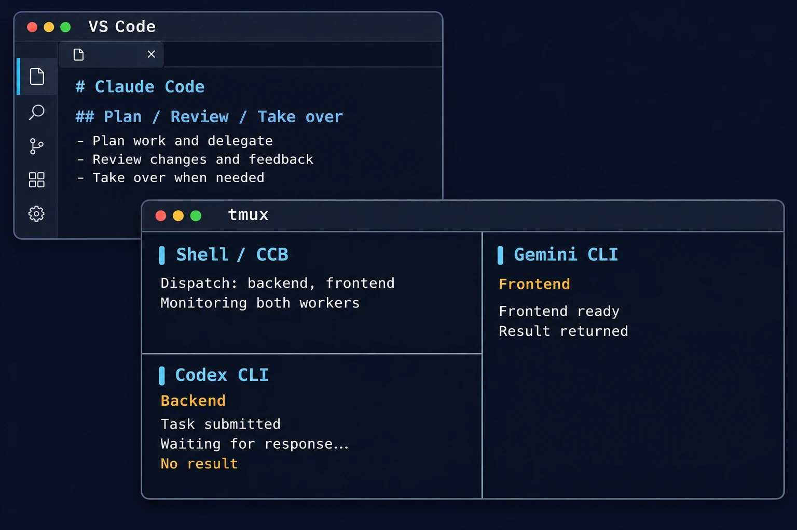
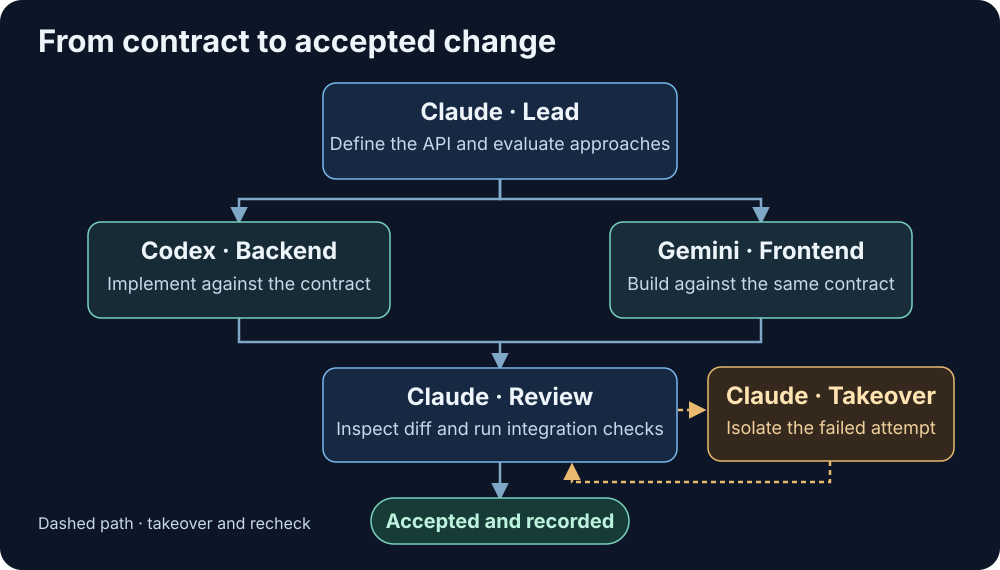
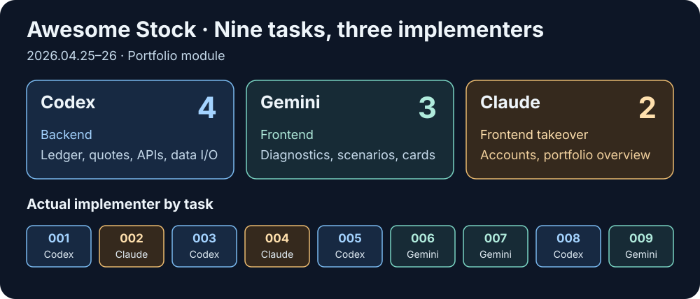
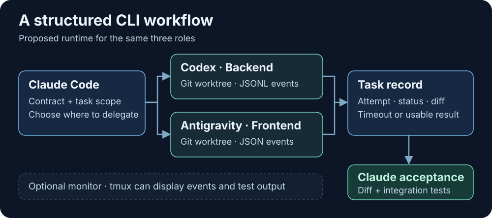

# Multi-Agent Dev Team

**Make Claude, Codex, and Gemini work as one development team.**

Claude Code scopes the work, evaluates approaches, and reviews the result. Codex implements the backend and Gemini implements the frontend against a shared contract. If a worker stalls, Claude can take over, and the task record shows who delivered the change.

[Quick start](#quick-start) · [Project history](docs/history.md) · [Current runtime design](docs/runtime.md)



*Reconstructed from the first integration trial in March 2026. Claude Code ran in VS Code. A separate tmux window showed the dispatch shell, the backend worker, and the frontend worker. Gemini returned the page while the Codex task was still awaiting a result.*

## How the team ships a change

| Role | Tool | Responsibility |
| --- | --- | --- |
| Lead | Claude Code | Define the interface and acceptance checks, evaluate approaches, review diffs and tests, and take over when needed. |
| Backend engineer | Codex CLI | Implement APIs, data logic, and backend tests against the contract. |
| Frontend engineer | Gemini, via Antigravity CLI for individual accounts | Implement the UI and interactions against the same contract. Start with a mock response when helpful. |



Each task states its writable files, base commit, and acceptance criteria. Independent tasks can run in parallel, with one active writer per file. Before accepting a change, Claude inspects the actual diff, runs the checks, and records who completed the work.

## From the March prototype to Awesome Stock

**March 17–18 · Setup and first integration.** Claude Code ran in VS Code and sent tasks through CCB to Codex CLI and Gemini CLI in separate tmux panes. In the Hello API trial, Gemini returned a working frontend. The Codex task produced no result, so Claude implemented the backend and verified the integration.

**April 25–26 · A real application.** In the portfolio module of [Awesome Stock](https://github.com/JayeeeJY/awesome-stock), Codex delivered the ledger data layer, position-pricing APIs, diagnostics and journal APIs, and import/export. Gemini delivered the diagnostics page, scenario page, and dashboard card. Claude took over the account-page scaffold and portfolio overview.



**May 2 · PM-Pro.** The second design captured the API contract, task records, layered review, and takeover procedure as reusable rules. The nine-task record shows what the team delivered and where it needed a fallback. Speed and cost improvements still need a comparison against a baseline. [Full project history](docs/history.md)

## Quick start

Run from the repository root with Node.js 22 or newer.

```sh
node --test examples/hello-api/contract.test.mjs
node examples/hello-api/server.mjs
```

Open <http://127.0.0.1:3000> and select **Fetch message**. The page shows a message and timestamp from the same-origin API. The example needs no package install or model account. Stop it with `Ctrl+C` or set `PORT=3001` to use another port. [Example instructions](examples/hello-api/README.md)

Select **Use this template** to start a new repository, or copy the [Claude project rules](CLAUDE.md), [API contract](templates/api-contract.md), and [task sheet](templates/task.md) into an existing project. The [worked handoff](examples/hello-api/handoff.md) includes two example tasks and commands to start separate worktrees from the same base commit.

## Running the team today

Keep the three roles. For automated dispatch, use the official non-interactive CLIs, run each write task in its own Git worktree, and keep machine-readable results with the task record. Use Antigravity CLI for individual Gemini accounts. tmux can display progress while the lead uses diffs and test results to accept work.



The current release includes the rules, manual handoff, and local example. The [runtime design and vendor references](docs/runtime.md) cover automated dispatch, result handling, and takeover.

[MIT](LICENSE) applies to this repository's materials. The historical prototype used the independent [Claude Code Bridge](https://github.com/SeemSeam/claude_codex_bridge), which has its own [license](https://github.com/SeemSeam/claude_codex_bridge/blob/main/LICENSE).
