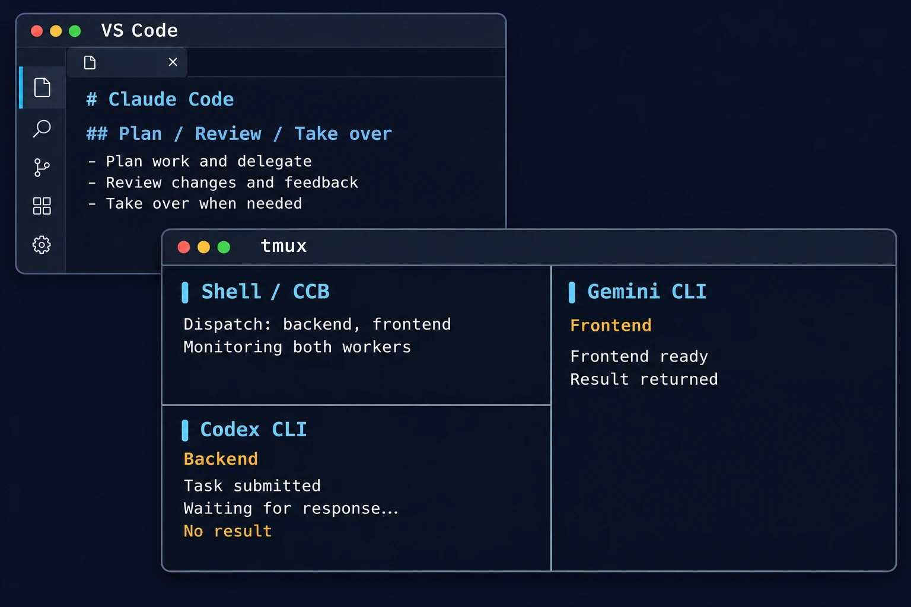
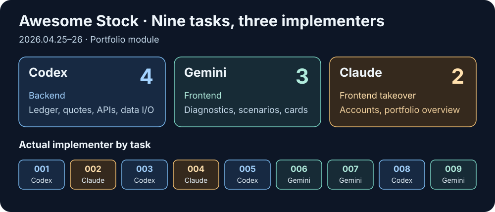

# From a three-pane prototype to a real project

[简体中文](history.md) · [Back to README](../README.en.md)

The project began with a practical question. Could Claude own planning and acceptance while two other coding agents implemented the frontend and backend, and could the team still deliver if one worker stalled? The earliest surviving setup scripts and workflow notes date to **March 17, 2026**. The first project document and trial log followed on March 18. The project used PM and PM-Pro as working names.

## March 17 · Building the workstation

*Reconstruction from the original notes. The separate terminal had Shell/CCB in the upper-left pane, Codex in the lower-left pane, and Gemini in the full-height pane on the right.*

Claude Code ran in the VS Code integrated terminal. It set the interface, evaluated implementation approaches, and reviewed work from both workers. OpenAI's Codex CLI handled the backend and Google's Gemini CLI handled the frontend. Claude Code Bridge (CCB) relayed the tasks asynchronously. tmux made both workers' progress visible alongside the dispatch shell.

## March 18 · Hello API

The scope was a single `GET /api/hello` endpoint that returned a message and timestamp, plus a page that displayed both after a button click. Claude fixed the contract and dispatched two tasks through CCB.

| Task | Assigned to | Delivered by | Outcome |
| --- | --- | --- | --- |
| Express endpoint | Codex CLI | Claude Code | The bridge acknowledged submission, but no completed result returned. Claude took over. |
| HTML page | Gemini CLI | Gemini CLI | Gemini delivered the fetch button, loading state, and error handling. |
| Integration and record | Claude Code | Claude Code | Claude verified the response and browser interaction and recorded both tasks. |

The trial showed that the frontend handoff and fallback worked. The precise cause of the missing Codex result remained uncertain. The [public Hello API example](../examples/hello-api/README.md) recreates the interface with Node.js built-ins so readers can run it independently.

## April 25–26 · Awesome Stock

The first nine tasks in the portfolio module of [Awesome Stock](https://github.com/JayeeeJY/awesome-stock) had task briefs and a separate delivery log. The briefs show who was assigned. The delivery log shows who completed the work.

| Actual implementer | Tasks | Deliverables |
| --- | --- | --- |
| Codex | 001, 003, 005, 008 | Ledger data layer, position pricing and exchange rates, diagnostics and journal APIs, import and export. |
| Gemini | 006, 007, 009 | Portfolio diagnostics page, scenario page, dashboard card. |
| Claude takeover | 002, 004 | Accounts and routing scaffold, portfolio overview. |

An existing tmux pane could contain a regular shell and still pass the old health check. A Gemini session-format change also made some completed replies unreadable to the bridge. After repair, a short message made the round trip. These incidents informed the proposed use of explicit task events and acceptance evidence.

## May 2 · PM-Pro

The second design made the API contract, file ownership, and review steps explicit. It proposed automated checks, review by Claude, and optional cross-review. The surviving records show how tasks were delivered and reassigned. Speed, cost, and quality gains still require a comparison on the same work.
