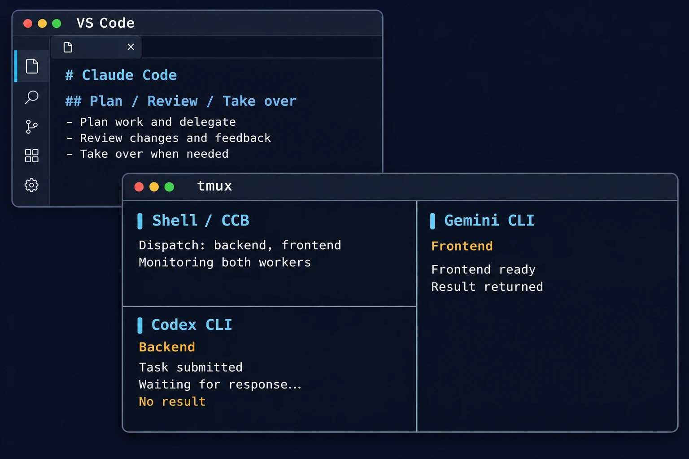
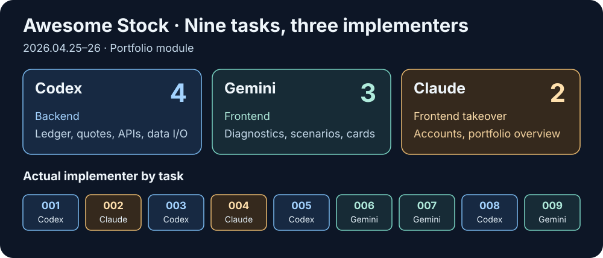

# 从三窗格原型到真实项目

[English](history.en.md) · [返回首页](../README.md)

这套方案从一个具体问题出发。能否让 Claude 管需求和验收，让两个不同的编码智能体分别写前端和后端，并在执行中断时继续交付？现存的搭建脚本和工作流记录最早可追溯到 **2026 年 3 月 17 日**，首份项目文档和演示日志记于次日。项目曾使用 PM、PM-Pro 两个内部代号。

## 3 月 17 日 · 搭建工作台

*历史布局重绘。独立终端采用左上 Shell/CCB、左下 Codex、右侧整栏 Gemini 的布局。图中的状态文字依据首次试跑结果绘制。*

- **Claude Code CLI** 从 Visual Studio Code（VS Code）的集成终端接收需求。它制定接口，评估前后端的方案和交付，并在执行者卡住时接手。
- **Codex CLI** 是当时任务单里对应 OpenAI/GPT 的后端执行者。**Gemini CLI** 是前端执行者。两边都有各自的终端窗格，可按已经确认的接口并行推进。
- **Shell / CCB** 用于异步传递任务和查看结果。tmux 三个窗格同步显示进度，方便观察谁在执行、谁还在等待。

## 3 月 18 日 · 首次联调

Hello API 的契约很小。`GET /api/hello` 返回 `message` 和 `timestamp`，页面点击按钮后读取并展示结果。Claude 定义契约后，通过 CCB 派出两个任务。

| 任务 | 原分派 | 实际执行 | 记录 |
| --- | --- | --- | --- |
| Express 接口 | Codex CLI | Claude Code | 桥接确认提交，执行结果未返回。Claude 接手实现。 |
| HTML 页面 | Gemini CLI | Gemini CLI | 完成点击发请求、加载提示和错误显示。 |
| 联调与归档 | Claude Code | Claude Code | 检查 API 响应，打开页面验证交互，归档两个任务。 |

首次试跑实际验证了前端委派、接口交接和负责人兜底。日志记录了 Codex 未返回结果，具体根因当时仍是推测。仓库的 [Hello API 示例](../examples/hello-api/) 根据这次试跑重新制作，使用 Node.js 内置模块，便于独立运行。

## 4 月 25–26 日 · Awesome Stock

[Awesome Stock](https://github.com/JayeeeJY/awesome-stock) 的投资组合模块留下了九份任务单和一份实际执行日志。四项后端任务由 Codex 完成，三项前端任务由 Gemini 完成，另外两项前端任务由 Claude 接手。原任务单保留分派对象，交付日志记录实际执行人。

| 实际执行者 | 任务 | 交付 |
| --- | --- | --- |
| Codex | 001、003、005、008 | 账本基础数据层，持仓行情和汇率接口，诊断与日记 API，导入导出。 |
| Gemini | 006、007、009 | 持仓诊断页，假设推演页，仪表板组合卡片。 |
| Claude 接手 | 002、004 | 账户页及路由骨架，持仓总览页。 |

期间发现，终端窗格存在也可能对应一个普通 shell，旧检活会误报在线。Gemini 更新会话文件格式后，桥接还一度无法读取已经产生的回复。修复后，短消息收发得到验证。这段经历直接影响了后来对任务回执的设计。

## 5 月 2 日 · PM-Pro

第二版把 API 契约、文件归属和验收步骤写得更明确，并提出自动检查、Claude 审核和可选交叉审查三层流程。它是一份能力方案。当时留下的是任务归档和案例日志，实际提速、成本和质量收益仍需要同任务的对照测量。
