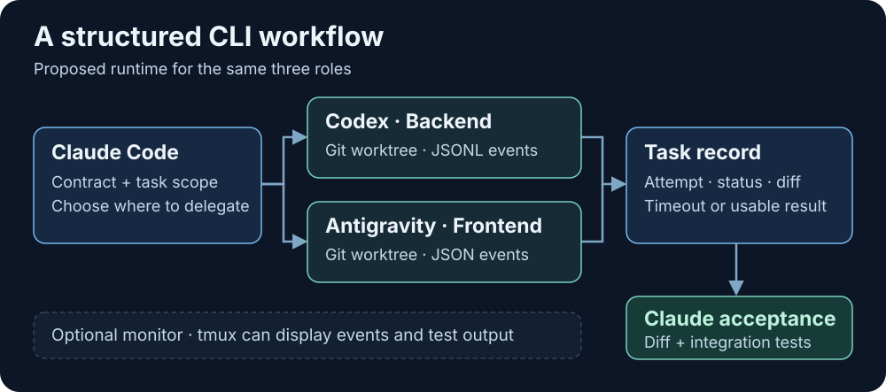

# Current runtime design

[简体中文](runtime.md) · [Back to README](../README.en.md)

Checked against vendor documentation on November 25, 2026. Keep Claude as lead, Gemini on the frontend, and Codex on the backend. The proposed automated path uses official non-interactive CLIs, separate Git worktrees, and tmux as an optional monitor. This release includes the workflow, manual handoff, and local example.

| Role | Recommended interface | Source |
| --- | --- | --- |
| Claude Code · lead | Use the interactive session to clarify and review work. Use `claude -p` with structured output if the lead needs to run programmatically. | [Claude Code](https://code.claude.com/docs/en/headless) |
| Codex · backend | For automation, run `codex exec --json` in a dedicated worktree with permissions appropriate to the task. | [Codex CLI](https://developers.openai.com/codex/noninteractive/) |
| Gemini · frontend | Use Antigravity CLI for individual accounts. `agy -p` supports JSON, streamed JSON, and a configurable timeout. | [Google migration announcement](https://developers.googleblog.com/an-important-update-transitioning-gemini-cli-to-antigravity-cli/) · [Antigravity CLI](https://antigravity.google/docs/cli/headless/) |
| tmux · monitoring | Show task progress and output. Keep the durable result with the task so it remains available after terminal reconnects. | [Historical workstation](history.en.md) |

Google moved free individual, Google AI Pro, and Ultra users from Gemini CLI to Antigravity on June 18, 2026. Standard and Enterprise follow a separate schedule. [Google account changes](https://developers.google.com/gemini-code-assist/docs/deprecations/code-assist-individuals?hl=en)

## Reliable task results

1. Record the task ID, attempt number, base commit, writable files, and acceptance checks. Start independent write tasks from the same confirmed commit in separate worktrees. Use read-only permissions for advisory work.
2. Track assignment, acknowledgement, and usable completion separately. Store process exit status, structured result, diff, and test output. A model completion event can arrive even when a tool action was denied. Judge acceptance from the files and checks.
3. Stop a stalled attempt or isolate its worktree before reassigning the task. Start a new attempt from a known commit. Mark any late result from the old attempt as superseded. Claude reviews the integrated diff and repeats the checks.

Manual handoff is the quickest way to try the template. Existing CCB users can keep their interactive setup independently. Claude Code Agent Teams coordinates multiple Claude Code instances. This three-provider workflow uses separate CLI calls for Codex and Gemini. [CCB upstream](https://github.com/SeemSeam/claude_codex_bridge) · [Claude Code Agent Teams](https://code.claude.com/docs/en/agent-teams)
