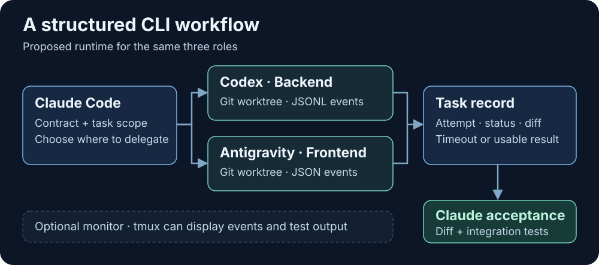

# 当前技术方案

[English](runtime.en.md) · [返回首页](../README.md)

2026 年 11 月 25 日核对。建议**保留 Claude 主管、Gemini 前端、Codex 后端的角色，派活采用官方非交互 CLI，变更采用独立 Git worktree，tmux 用作可选监控**。模板和本地示例是当前交付，自动调度是本页记录的设计。

## 各角色怎么运行

| 角色 | 当前建议 | 接入依据 |
| --- | --- | --- |
| Claude Code · 主管 | 日常用交互会话，人与 Claude 确认接口和验收。需要脚本化时用 `claude -p` 和结构化输出。 | [Claude Code 非交互文档](https://code.claude.com/docs/en/headless) |
| Codex · 后端 | 自动模式由 `codex exec --json` 启动独立任务，使用专属 worktree 和适合任务的沙箱。 | [Codex 非交互文档](https://developers.openai.com/codex/noninteractive/) |
| Gemini · 前端 | 个人账号采用 Antigravity CLI。`agy -p` 提供 JSON 或 `stream-json`，可限制单次运行时间。 | [Google 迁移公告](https://developers.googleblog.com/an-important-update-transitioning-gemini-cli-to-antigravity-cli/) · [Antigravity CLI 非交互文档](https://antigravity.google/docs/cli/headless/) |
| tmux · 观察 | 在窗格里显示任务状态、测试和输出。终端关闭或重连以后，任务结果仍由自己的记录确定。 | [历史工作台](history.md) |

Google 在 2026 年 6 月 18 日迁移了 Gemini CLI 的免费个人、Google AI Pro 与 Ultra 用户。Standard 和 Enterprise 适用独立时间表，已有这些权限的用户可以按 Google 文档选择接入路径。 [Google 账号变动说明](https://developers.google.com/gemini-code-assist/docs/deprecations/code-assist-individuals?hl=en)

## 如何让回执可靠

1. **每次运行有独立边界。** 任务单带上任务 ID、尝试编号、基准提交、文件范围和验收命令。每个并行写入任务从相同的已确认提交开独立 worktree。模型建议只需读文件时，用只读权限。
2. **派出、收到和完成分别记录。** 给每次运行记录启动时间、退出状态、候选 diff 和测试结果。Codex 的 `turn.completed` 和 Antigravity 的 `SUCCESS` 可用来判断模型有没有交回结果。工具操作仍可能被权限策略拒绝，实际文件和验收结果决定能否通过。 [Codex 事件格式](https://developers.openai.com/codex/noninteractive/) · [Antigravity 权限与状态](https://antigravity.google/docs/cli/headless/)
3. **接管前切断旧尝试。** 超时后停止本次进程，或将原 worktree 从集成流程隔离。为接管新建尝试编号，旧结果迟到时保留审计记录。Claude 比较实际 diff，验证合并后的接口和测试，再确认验收。

## 为什么选这条路径

| 方案 | 适用情况 | 对这个项目的判断 |
| --- | --- | --- |
| 官方 CLI + 手动交接 | 快速试用模板、任务量小 | 首版起点。可以当场检查任务和差异。 |
| 官方 CLI + 结构化回执 | 经常并行派活，需要复查超时和接管 | 推荐的自动化路径。各家各自升级，由薄适配层统一任务状态。 |
| CCB + tmux | 已配置 CCB，想保留可视终端和交互式会话 | 可独立选用。发布仓只描述历史接入，自动化设计依赖官方事件。 [CCB 上游](https://github.com/SeemSeam/claude_codex_bridge) |
| Claude Code Agent Teams | 想让多个 Claude Code 实例共享任务并互相沟通 | 适合 Claude 内部协作。三厂商分工仍需要独立的 CLI 调用。 [Agent Teams 文档](https://code.claude.com/docs/en/agent-teams) |

试用时可以先用任务单手动交接一次。需要验证工具和账号时，分别在测试仓运行一条只读检查，再测试有明确文件范围的写入任务。示例的本地契约测试无需模型账号。
